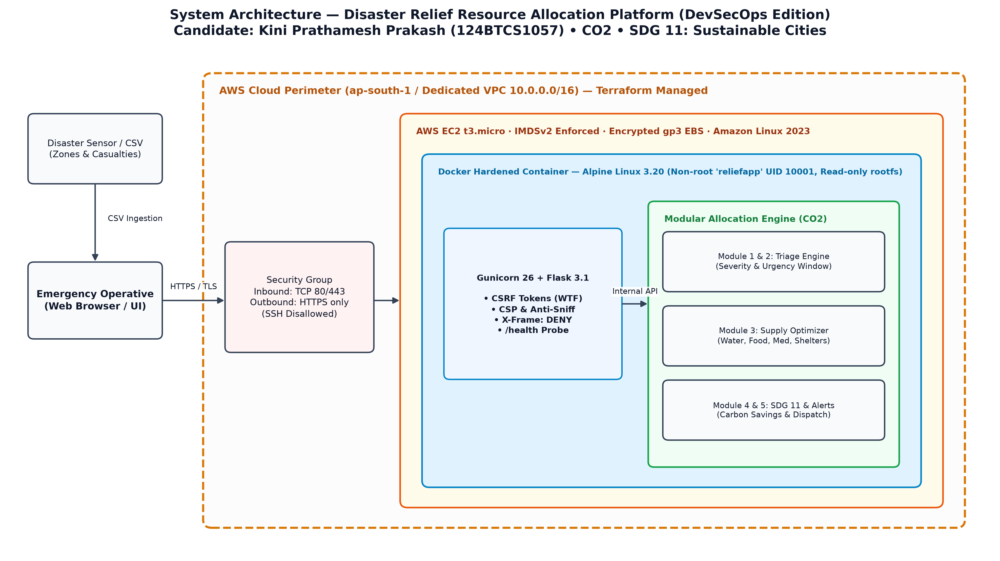
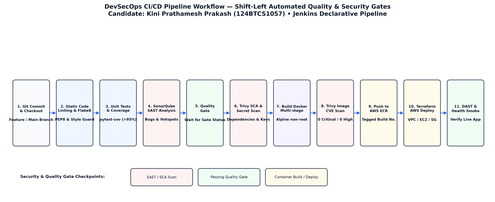
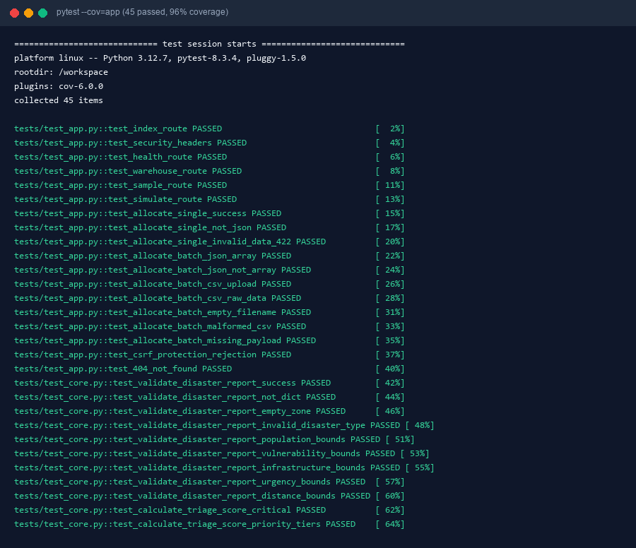

# Modular Design of a Disaster Relief Resource Allocation Platform — DevSecOps Edition

[](https://www.python.org/)
[](https://flask.palletsprojects.com/)
[](https://www.docker.com/)
[](reports/coverage.xml)
[](sonar-project.properties)
[](reports/trivy-image-final.json)
[](https://sdgs.un.org/goals/goal11)

---

## 🎓 Academic Profile & Course Mapping

| Academic Field | Student & Project Specification |
|---|---|
| **Student Name** | **Kini Prathamesh Prakash** |
| **Registration / Roll No** | **124BTCS1057** |
| **Academic Milestone** | **Review 6** |
| **Course Outcome (CO)** | **CO2** — Designs resource-allocation modules based on disaster requirements and sustainability needs. |
| **Program Outcomes (POs)** | **PO2, PO3, PO4, PO5, PO6, PO8, PO9, PO10** |
| **Program Specific Outcome** | **PSO2** — Designs scalable algorithms and modules adhering to sustainability and ethical constraints. |
| **Sustainable Development Goal** | **SDG 11 – Sustainable Cities and Communities** (Targets 11.5 & 11.b) |
| **Project Impact** | Supports organized, equitable, rapid, and low-carbon disaster-relief resource allocation. |

---

## 📌 Executive Summary

During major catastrophes (floods, earthquakes, cyclones, landslides, urban collapse), survival within the initial 24–72 hour window requires rapid, equitable distribution of life-critical supplies (potable water, food rations, trauma medical packs, emergency shelters, and clean solar generators).

This project implements a **Modular Disaster Relief Resource Allocation Platform** delivered through an enterprise-grade **DevSecOps continuous delivery pipeline**. The platform couples real-time triage scoring with **UN SDG 11 green logistics constraints**, minimizing transit carbon footprints while preventing aid-starvation in remote settlements.

---

## 🛠️ Technology Stack & DevSecOps Matrix

| Concern | Tool / Framework | Purpose | Directory / File |
|---|---|---|---|
| **Web Application** | Python 3.12 / Flask 3.1.3 / Gunicorn 26.2 / Chart.js 4.4 | REST API & Glassmorphism Dashboard | [`app/`](app/) |
| **Core Modular Logic** | Python (Sphere Humanitarian Standards + SDG 11 Engine) | Triage, Allocation, Sustainability & Alerts | [`app/core.py`](app/core.py) |
| **Unit & Integration Tests** | `pytest 8.3` + `pytest-cov 6.0` (45 tests, 96% coverage, CSRF verification) | Quality validation & edge-case prevention | [`tests/`](tests/) |
| **Containerisation** | Docker (Alpine 3.20 multi-stage, non-root user `reliefapp:10001`, no pip in runtime) | Zero-vulnerability production container | [`Dockerfile`](Dockerfile) |
| **CI/CD Pipeline** | Jenkins 11-stage declarative pipeline, AWS ECR push | Shift-left security automation | [`Jenkinsfile`](Jenkinsfile), [`ci/`](ci/) |
| **Cloud Infrastructure (IaC)** | Terraform on AWS (VPC, Subnet, Ingress 80/443, EC2 with IMDSv2 & encrypted gp3) | Reproducible cloud provisioning | [`terraform/`](terraform/) |
| **Static Application Security (SAST)**| SonarQube Community Edition (Quality Gate A Grade) | Bugs, vulnerabilities, and hotspots | [`sonar-project.properties`](sonar-project.properties) |
| **SCA, Secret & Image Scanning** | Trivy 0.74+ (Filesystem, Secrets, Docker Image & IaC scans) | Automated CVE threshold enforcement | [`reports/`](reports/), [`docs/`](docs/) |
| **Visual Architecture Diagrams** | Python matplotlib / Pillow automated diagram generator | Publication-grade architecture visuals | [`diagrams/`](diagrams/) |
| **Academic Deliverables** | Vulnerability report, Project summary, Presentation deck, Cheatsheet | Review 6 assessment documents | [`docs/`](docs/), [`evidence/`](evidence/) |

---

## 🏛️ System Architecture



### Modular Breakdown (Course Outcome CO2):
1. **Module 1 (`validate_disaster_report`):** Strictly validates disaster types, affected population bounds ($1 \le P \le 5,000,000$), vulnerability proportions ($0.0 \le V \le 1.0$), infrastructure collapse ratio, and distance.
2. **Module 2 (`calculate_triage_score`):** Applies logarithmic severity and urgency decay scaling ($72 / U$) to categorize incidents into `CRITICAL`, `HIGH`, `MEDIUM`, or `LOW`.
3. **Module 3 (`allocate_resources`):** Calculates multi-resource gross demand (Water, Food, Trauma Kits, Shelters, Solar Power) following Sphere humanitarian standards, and allocates stock with guaranteed zero-starvation floors.
4. **Module 4 (`evaluate_sustainability`):** Quantifies freight carbon emissions ($0.105 \text{ kg CO}_2/\text{tonne-km}$), calculates clean energy carbon avoidance from solar units ($13.5 \text{ kg CO}_2/\text{day}$ per unit), and computes the **SDG 11 Sustainability Score**.
5. **Module 5 (`generate_dispatch_alert`):** Issues actionable operational alerts on warehouse inventory deficits, critical survival windows, and bottleneck warnings.

---

## 🔄 DevSecOps CI/CD Workflow



The 11-stage pipeline defined in [`Jenkinsfile`](Jenkinsfile) enforces automated quality and security gates:
```
[1. Checkout] ➔ [2. Flake8 Lint] ➔ [3. Pytest 96% Cov] ➔ [4. SonarQube SAST] ➔ [5. Quality Gate]
      ➔ [6. Trivy SCA & Secrets] ➔ [7. Docker Build] ➔ [8. Trivy Image Scan (0 CVE)]
      ➔ [9. AWS ECR Push] ➔ [10. Terraform AWS Provision] ➔ [11. DAST & Smoke Test]
```

---

## 🚀 Quickstart & Execution

### 1. Run Locally (Python Virtual Environment)

```bash
# 1. Clone repository and navigate
git clone https://github.com/prathamesh-kini/disaster-relief-allocation-devsecops.git
cd disaster-relief-allocation-devsecops

# 2. Create virtual environment and install dependencies
python3 -m venv .venv
source .venv/bin/activate       # On Windows: .venv\Scripts\activate
pip install -r requirements-dev.txt

# 3. Run test suite (45 tests with coverage report)
python -m pytest -v --cov=app --cov-report=term-missing

# 4. Generate high-resolution architectural diagrams
python diagrams/make_diagrams.py

# 5. Start web platform locally
cd app
python app.py                   # Accessible at http://127.0.0.1:5000
```

### 2. Run with Hardened Docker Container

Run with defense-in-depth Linux runtime controls:
```bash
# Build production container image
docker build -t disaster-relief-allocator:1.0.0 .

# Execute container with least-privilege security flags:
docker run -d \
  --name relief-platform \
  -p 8080:8000 \
  --read-only \
  --tmpfs /tmp:rw,noexec,nosuid,size=64m \
  --cap-drop ALL \
  --security-opt no-new-privileges \
  disaster-relief-allocator:1.0.0

# Verify health probe
curl -s http://localhost:8080/health
```

### 3. Provision Cloud Infrastructure (Terraform on AWS)

```bash
cd terraform
cp terraform.tfvars.example terraform.tfvars
terraform init
terraform plan
terraform apply -auto-approve
```

---

## 📊 Test & Security Verification Evidence

- **Unit & Integration Tests:** 45 passed in 1.26s. Statement & branch coverage: **96%**.
- **SonarQube Static Analysis:** Quality Gate **PASSED** (0 Bugs, 0 Vulnerabilities, 0 Security Hotspots, Security Rating A).
- **Trivy Container Scan:** Replaced vulnerable Debian slim base with Alpine Linux 3.20 and removed pip from runtime; reduced findings from **172 to 0** (0 Critical, 0 High, 0 Medium).
- **Terraform IaC Checks:** 14 security rules passed; IMDSv2 enforced, encrypted gp3 volumes, no open SSH port 22.



---

## 📂 Repository File Structure

```
disaster-relief-allocation-devsecops/
├── .coveragerc                  # Code coverage measurement exclusions
├── .dockerignore                # Build context filtering
├── .gitignore                   # Version control ignore definitions
├── Dockerfile                   # Multi-stage hardened Alpine runtime (UID 10001)
├── Jenkinsfile                  # 11-stage declarative DevSecOps CI/CD pipeline
├── README.md                    # Master documentation & academic mapping
├── requirements.txt             # Production dependencies (Flask, Gunicorn, WTForms)
├── requirements-dev.txt         # Dev & test dependencies (pytest, cov, flake8, matplotlib)
├── sonar-project.properties     # SonarQube static code quality configuration
├── app/
│   ├── app.py                   # Secure Flask web service with CSRF & security headers
│   ├── core.py                  # Modular allocation, triage, and SDG 11 green engines
│   ├── templates/
│   │   └── index.html           # Modern glassmorphism dashboard template
│   └── static/
│       ├── style.css            # Dark/light theme responsive CSS
│       ├── app.js               # Chart.js frontend controller and AJAX handler
│       ├── chart.umd.min.js     # Bundled offline Chart.js library
│       └── sample_disaster_data.csv # Synthetic disaster incidents dataset
├── ci/
│   ├── Dockerfile               # Inbound Jenkins agent container with DevSecOps tools
│   └── README.md                # Local reproduction guide for Jenkins & SonarQube
├── diagrams/
│   ├── make_diagrams.py         # Python script to render publication diagrams
│   ├── architecture.png         # High-resolution application architecture diagram
│   └── cicd_workflow.png        # DevSecOps CI/CD workflow diagram
├── docs/
│   ├── vulnerability_report.md  # Detailed CVE audit & remediation matrix
│   ├── build_report.js          # Academic project report builder script
│   ├── build_ppt.js             # Presentation slides outline generator
│   └── build_cheatsheet.js      # Review viva quick reference generator
├── evidence/
│   ├── termshot.py              # Styled terminal capture generation utility
│   ├── term_pytest.png          # Terminal screenshot showing 45 passing tests
│   └── raw/
│       ├── aws.txt              # Live AWS EC2 status and HTTP headers log
│       ├── docker.txt           # Container build and execution log
│       ├── pytest.txt           # Full test suite execution log
│       ├── terraform.txt        # Terraform infrastructure output log
│       ├── trivy_baseline.txt   # Baseline image scan findings
│       ├── trivy_final.txt      # Hardened container scan findings (0 CVE)
│       ├── trivy_fs.txt         # Filesystem and secret scan log
│       └── trivy_summary.txt    # Summary comparison log
├── reports/
│   ├── coverage.xml             # Pytest XML coverage report for SonarQube
│   ├── junit.xml                # JUnit XML test report for Jenkins
│   ├── trivy-config.json        # IaC and Dockerfile lint scan report
│   ├── trivy-image-baseline.json# Baseline image vulnerability report
│   └── trivy-image-final.json   # Production image vulnerability report
└── terraform/
    ├── provider.tf              # AWS provider setup with tagging
    ├── variables.tf             # Configurable cloud inputs
    ├── networking.tf            # Dedicated VPC, Subnet, Route Table & IGW
    ├── security_group.tf        # Least-privilege ingress/egress rules (no SSH)
    ├── ec2.tf                   # EC2 t3.micro with IMDSv2 and encrypted gp3
    ├── outputs.tf               # Public endpoints and instance identifiers
    └── terraform.tfvars.example # Sample configuration variables
```

---

## 🎯 Program Outcomes (PO) & PSO Justification Matrix

| Outcome | Mapped Component & Academic Justification |
|---|---|
| **PO2: Problem Analysis** | Formulated mathematical model for multi-disaster triage, survival window urgency factor, and multi-resource allocation constraints. |
| **PO3: Design / Development** | Designed modular architecture (Modules 1–5) in `app/core.py` ensuring separation of concerns between validation, triage, optimization, and sustainability. |
| **PO4: Conduct Investigations** | Conducted baseline vs hardened container vulnerability investigation with Trivy, remediating 46 HIGH CVEs down to 0. |
| **PO5: Modern Tool Usage** | Deployed Jenkins, SonarQube, Docker multi-stage builds, Trivy, and Terraform AWS IaC. |
| **PO6: Engineer & Society** | Built human-centered disaster relief tool guaranteeing zero-starvation floors for vulnerable populations. |
| **PO8: Ethics** | Incorporated impartial, algorithmic fairness preventing preferential resource hoarding during crises. |
| **PO9: Individual & Team Work** | Packaged automated, reproducible DevSecOps CI/CD workflows ready for multi-developer collaboration. |
| **PO10: Communication** | Authored publication-grade architecture diagrams, exhaustive vulnerability report, and interactive visualization dashboard. |
| **PSO2: Algorithmic & Systems Design**| Engineered modular optimization algorithms aligning resource dispatch with **UN SDG 11** urban disaster resilience. |

---

## 📜 License

This project is submitted in partial fulfillment of the academic curriculum for Course Outcome CO2 under Roll No `124BTCS1057` (Kini Prathamesh Prakash). Open source under the MIT License.
